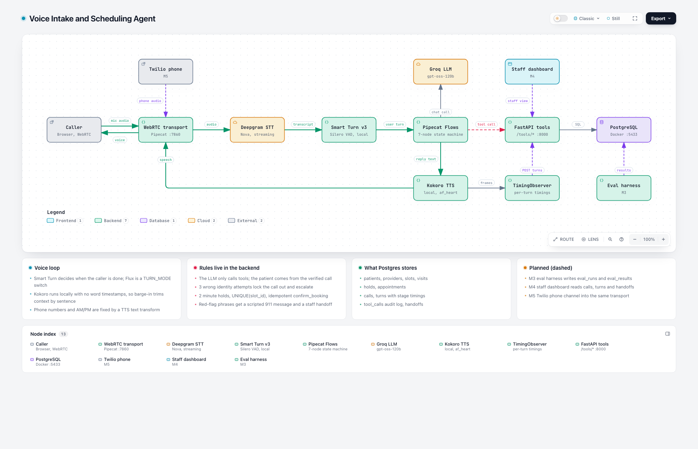
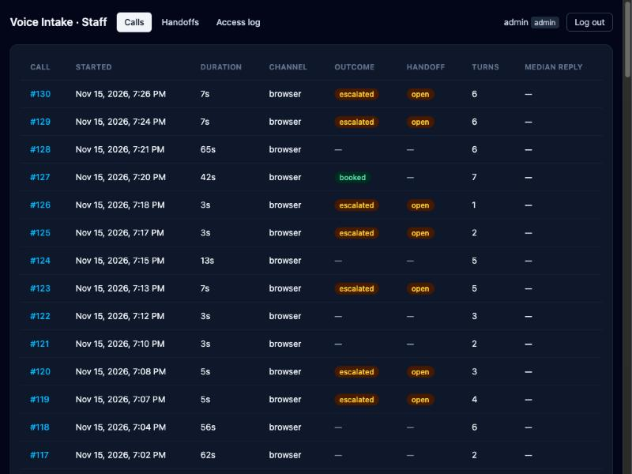
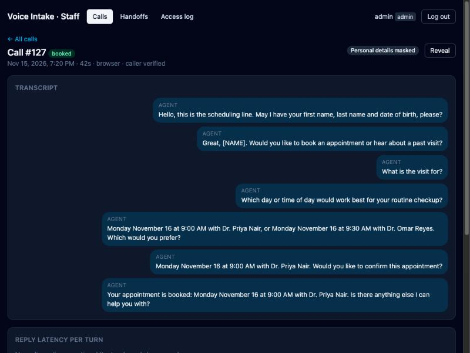

# Voice Intake & Scheduling Agent

A real-time voice agent for a **fictional** medical office. A caller talks to it in the browser. It verifies who they are, asks why they're calling, screens for emergencies, books an appointment with a read-back, and hands the call to a human when it can't help. Built with [Pipecat](https://github.com/pipecat-ai/pipecat), FastAPI and Postgres.

**Synthetic data only.** The design is HIPAA-aware, but this project is not HIPAA compliant and makes no compliance claims. See [`docs/COMPLIANCE_NOTES.md`](docs/COMPLIANCE_NOTES.md).

## Architecture



The diagram is generated with archify and is interactive (zoom, route highlighting, light and dark themes). GitHub doesn't run scripts inside a README, so open [`docs/architecture.html`](docs/architecture.html) locally for the interactive version. Dashed arrows are planned.

## What it does

1. **Verifies** the caller by name and date of birth. Three wrong attempts lock the call out and hand off to staff.
2. **Collects** the reason for the visit.
3. **Screens for emergencies.** A red-flag phrase such as "chest pain" gets a scripted "call 911" message and a staff handoff, with no LLM improvisation.
4. **Books** a slot: find, hold for two minutes, read back, confirm only after a clear yes.
5. **Escalates** to a human with a structured summary when asked, when verification fails, or when a backend call breaks.

## Staff dashboard




Transcripts are masked by default. Only an admin can reveal them, only the staff member who claims a handoff can open the patient, and every view is written to an access log. Masking is best effort and happens on read: the stored text is raw.

## Design choices worth a look

- **The backend enforces the rules, not the prompt.** A verification gate, a partial unique index (one active hold per slot), `UNIQUE(appointments.slot_id)`, and an idempotent `confirm_booking`. A test sends five callers after one slot and exactly one wins.
- **The conversation is a state machine** ([Pipecat Flows](agent/flow.yaml)). The config decides every transition. The LLM only talks and calls tools, and it may only hold slot ids the backend returned.
- **Every tool call is audited** in `tool_calls`, with PII arguments stored empty.
- **Per-turn latency is measured** (user stops speaking, transcript final, first LLM token, first audio byte).
- **Evals check promises against the database.** A commitment ledger fails the run if the bot says "booked" with no appointment behind it, says staff will call with no handoff filed, or names a time that isn't the booked one.

Decisions and the evidence behind them are in [`docs/DECISIONS.md`](docs/DECISIONS.md).

## Status

| Milestone | State |
|---|---|
| M1 Voice loop, latency timing | Done |
| M2 Booking tools, Flows state machine, correctness tests | Done |
| M2.5 Read-only last-visit lookup (verified callers only, date, doctor and reason) | Done |
| M3 Eval harness | In progress: 6 scripted scenarios plus the commitment ledger. failure drill, paced runner. LLM-played callers still to do. GitHub Actions runs lint and unit tests on every push and PR (not the evals, which need API keys) |
| M4 Staff dashboard | Built: login with roles, calls list, call detail (masked transcript, latency per turn, tool calls, booking), handoff queue (claim, close, open patient), admin access log. Eval results page still to do |
| M5 Twilio phone number, demo video | Planned |

Known limits: transcripts are stored unmasked (masking is planned for M4); the emergency screen only checks the stated visit reason; the eval suite compresses a 2-3 minute call into seconds, so it hits Groq's free-tier limit (8,000 tokens a minute) and the bot falls back to a weaker model, which makes some scenarios flaky. If the LLM fails outright, the bot apologises and hands off to staff instead of going silent.

## Run it

Needs Docker, [uv](https://docs.astral.sh/uv/), a Groq key and a Deepgram key. Speech output uses a local Kokoro model.

```bash
cp .env.example .env            # then add GROQ_API_KEY and DEEPGRAM_API_KEY
docker compose up -d postgres
cd backend
docker compose exec -T postgres psql -U voice -d voice_intake < app/db/schema.sql   # once: creates the tables
uv run python -m app.db.seed
uv run uvicorn app.main:app --port 8000
```

In a second terminal:

```bash
cd agent && uv run bot.py -t webrtc
```

Open http://localhost:7860/client/ and press connect.

Staff dashboard (third terminal):

```bash
cd web && npm install && npm run dev   # http://localhost:5173
```

Demo logins from the seed file: `admin` / `admin-demo` (can reveal unmasked text and read the access log) and `frontdesk` / `frontdesk-demo`. Synthetic project only.

## Tests and evals

```bash
cd backend && uv run pytest     # tool endpoints, lockout, idempotency, the five-caller race
cd agent && uv run pytest       # flow handlers and ledger rules
cd agent && uv run python -m evals.run   # scripted callers, failure drill, then the commitment ledger (about 8 minutes: paced for Groq's free tier)
```

## Repo layout

```
agent/      Pipecat bot, Flows config, tool handlers, timing observer, evals
backend/    FastAPI tool endpoints and staff API, schema, seed data, tests
web/        React dashboard
docs/       SPEC, DECISIONS, COMPLIANCE_NOTES, LEARNING_PLAN, architecture diagram
```
